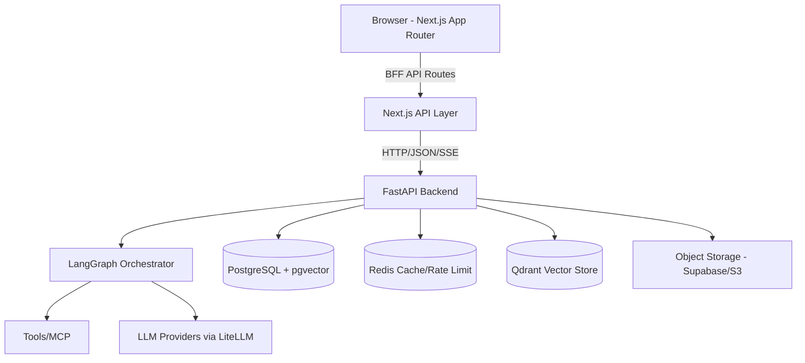

# Nexus AI Assistant

Nexus is a full-stack AI assistant platform with multi-agent orchestration, retrieval-augmented generation (RAG), tool use, streaming responses, and a modern Next.js interface backed by a FastAPI service.

## Features

- Multi-agent orchestration – LangGraph-powered agent flows with planning, routing, tool execution, and synthesis
- Streaming chat – Server-Sent Events with real-time token streaming and resumable runs
- RAG & knowledge – Document ingestion, chunking, and semantic search with vector storage (pgvector/Qdrant)
- Tools & MCP – Built-in tools plus FastMCP server integration
- Artifacts & files – Upload, manage, and share artifacts with rich rendering
- Usage & billing – Token tracking, cost estimation, and usage analytics
- Admin & orgs – Role-based access control, organization management, audit logging
- Observability – OpenTelemetry tracing/metrics, structured logging

## Architecture



## Tech Stack

**Frontend:** Next.js 16, React 19, TypeScript, TanStack Query, Tailwind CSS, Vercel AI SDK  
**Backend:** FastAPI, LangGraph, LangChain, SQLModel, Alembic, Pydantic v2, Uvicorn  
**Data & Infra:** PostgreSQL, pgvector, Redis, Qdrant, OpenTelemetry, Docker

## Quick Start

### Prerequisites
- Docker & Docker Compose
- Node.js 22+
- Python 3.12+
- uv

### Environment Setup
```bash
cp backend/.env.example backend/.env
```

### Run with Docker Compose
```bash
docker compose up --build
```
- Frontend: http://localhost:3000
- Backend API: http://localhost:8000
- API Docs: http://localhost:8000/docs

### Local Development

**Backend:**
```bash
cd backend
uv sync --group dev
uv run alembic upgrade head
uv run --project backend uvicorn backend.app.main:app --reload --host 0.0.0.0 --port 8000
```

**Frontend:**
```bash
cd frontend
npm ci --legacy-peer-deps
npm run dev
```

## Database
See [docs/database.md](docs/database.md) for schema details and ERD.

## Testing

**Backend:**
```bash
cd backend
uv run pytest -m "not e2e"
```

**Frontend:**
```bash
cd frontend
npm run test
npm run build
```

## License
See [LICENSE](LICENSE) for details.
