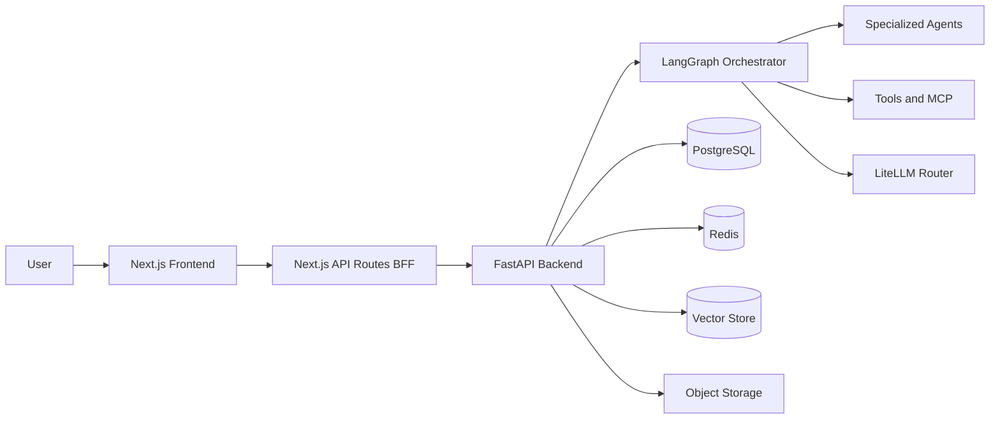
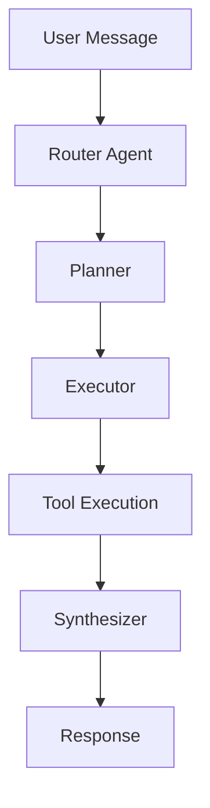

# Architecture

## System Overview

Nexus AI Assistant is a distributed application with a Next.js frontend and a FastAPI backend orchestrating multi-agent workflows.

## High-Level Flow

## Frontend
- App Router with React 19
- BFF pattern for authenticated requests
- TanStack Query for server state
- SSE streaming for chat

## Backend
- FastAPI with domain-driven structure
- LangGraph orchestration
- JWT authentication with OAuth
- Redis-backed rate limiting

## Agent Orchestration

## Data Layer
- PostgreSQL with pgvector
- Redis for caching and rate limiting
- Qdrant for vector search
- Object storage for files

## Observability
- OpenTelemetry tracing and metrics
- Structured logging
- Health and readiness checks
