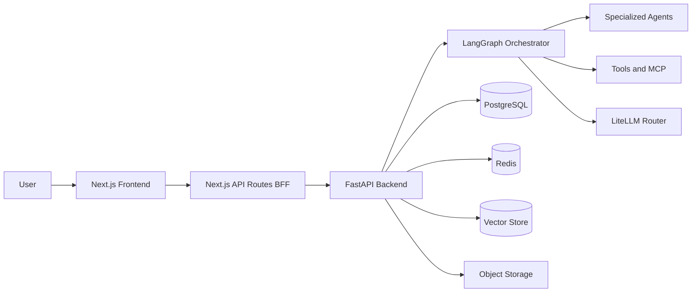
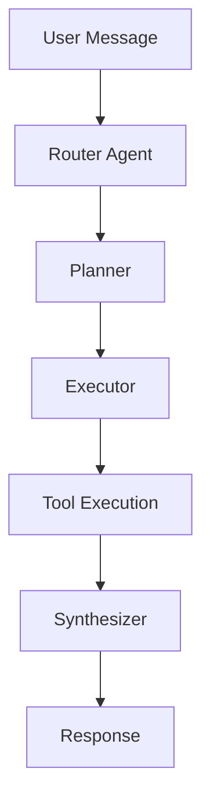

# Architecture

## System Overview

Nexus AI Assistant is a distributed application with a Next.js frontend and a FastAPI backend orchestrating multi-agent workflows.

## High-Level Flow

## Frontend
- App Router with React 19
- BFF pattern for authenticated requests
- TanStack Query for server state
- SSE streaming for chat

## Backend
- FastAPI with domain-driven structure
- LangGraph orchestration
- JWT authentication with OAuth
- Redis-backed rate limiting

## Authentication boundary

There are three sequential layers. Only the last one authorizes anything.

1. **Edge gate — `frontend/src/proxy.ts`.** An *optimistic* cookie-presence
   check on `/app` and `/signin`. It redirects a visitor who has neither session
   cookie before the workspace HTML/JS is rendered, and sends an already-signed-in
   visitor away from the sign-in form. It does **not** decode or validate the
   cookie: a stale or forged cookie still gets the shell, and the client-side
   probe decides the outcome. This is a UX/byte-saving check, **not** an
   authorization boundary, and no security decision may be added here.
2. **BFF — `frontend/src/lib/proxy.ts`.** Reads the httpOnly cookies on the
   server and forwards the access token to FastAPI as `Authorization: Bearer`.
   It also rejects cross-origin mutations by comparing `Origin` to the forwarded
   host (the app uses no Server Actions, so Next's built-in check never runs).
   It does not validate the token either; that is deliberate, so one backend
   verdict remains authoritative.
3. **FastAPI — `backend/app/api/deps.py`.** The real boundary. `resolve_access_token_user`
   verifies the signature and token type, checks the logout blacklist, and loads
   the active user row before any handler runs. The blacklist read is fail-open
   (an offline Redis must not brick authentication); the user/active check is
   not. Both the REST dependency and the MCP gate call this one function.

Cookie names are a single source of truth: `TOKEN_COOKIE`, `REFRESH_COOKIE`, and
`PREAUTH_COOKIE` in `frontend/src/lib/auth.ts`, imported by both the edge gate
and the BFF. A rename must change that one module, never a literal in a route.

## Agent Orchestration

## Data Layer
- PostgreSQL with pgvector
- Redis for caching and rate limiting
- Qdrant for vector search
- Object storage for files

## Observability
- OpenTelemetry tracing and metrics
- Structured logging
- Health and readiness checks
